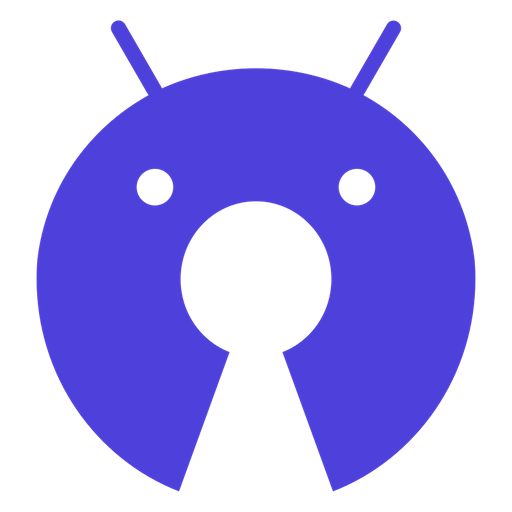

  
  <h2 align="center"><a href="https://www.openapk.net">OpenAPK</a></h2>
  
A curated list of awesome open source apps and games for Android. Updated daily!

### [Popular](#popular) &nbsp;&middot;&nbsp; [New](#new) &nbsp;&middot;&nbsp; [Updated](#updated) &nbsp;&middot;&nbsp; [Featured](#featured)

> [!TIP]
> To get your app listed, open an issue mentioning your repo !
> 
> Use our download banner in your repo readme !
> 
> 

## Categories
- [Automation](categories/automation.md)
- [Connectivity](categories/connectivity.md)
- [Development](categories/development.md)
- [Food](categories/food.md)
- [Games](categories/games.md)
- [Graphics](categories/graphics.md)
- [Internet](categories/internet.md)
- [Messaging](categories/messaging.md)
- [Money](categories/money.md)
- [Multimedia](categories/multimedia.md)
- [Navigation](categories/navigation.md)
- [Office](categories/office.md)
- [Phone & SMS](categories/phone-and-sms.md)
- [Reading](categories/reading.md)
- [Religion](categories/religion.md)
- [Science & Education](categories/science-and-education.md)
- [Security](categories/security.md)
- [Social Network](categories/social-network.md)
- [Sports & Health](categories/sports-and-health.md)
- [System](categories/system.md)
- [Theming](categories/theming.md)
- [Time](categories/time.md)
- [Weather](categories/weather.md)
- [Writing](categories/writing.md)
- [Xposed](categories/xposed.md)

## New

| App | Info |
| :--- | :--- |
|  | <a href="https://www.openapk.net/smeggtuner/me.smegg.smeggtuner/"><b>SmeggTuner</b></a> Accordion tuner with note, chord and WAV file analysis <a href="https://github.com/smegg99/SmeggTuner">Repo</a> &nbsp;&middot;&nbsp; <a href="https://www.openapk.net/smeggtuner/me.smegg.smeggtuner/apk/download">↓Download</a> &nbsp;&middot;&nbsp; by <a href="https://github.com/smegg99">@smegg99</a>|
|  | <a href="https://www.openapk.net/anything/com.callcraftstudio.anything/"><b>Anything</b></a> On-device Android filename search and file management <a href="https://github.com/shamrat05/anything">Repo</a> &nbsp;&middot;&nbsp; <a href="https://www.openapk.net/anything/com.callcraftstudio.anything/apk/download">↓Download</a> &nbsp;&middot;&nbsp; by <a href="https://github.com/shamrat05">@shamrat05</a>|
|  | <a href="https://www.openapk.net/inkwell/com.kodalibhargav.inkwell/"><b>Inkwell</b></a> Live ink and smoke wallpaper: fluid animation. Tap to drop, drag to stir. <a href="https://github.com/kb019/InkWell">Repo</a> &nbsp;&middot;&nbsp; <a href="https://www.openapk.net/inkwell/com.kodalibhargav.inkwell/apk/download">↓Download</a> &nbsp;&middot;&nbsp; by <a href="https://github.com/kb019">@kb019</a>|
|  | <a href="https://www.openapk.net/handy-ai/com.claudeagent.phone/"><b>Handy Ai</b></a> Voice-first AI agent that taps, types and swipes through Android apps <a href="https://github.com/fainir/handy-ai">Repo</a> &nbsp;&middot;&nbsp; <a href="https://www.openapk.net/handy-ai/com.claudeagent.phone/apk/download">↓Download</a> &nbsp;&middot;&nbsp; by <a href="https://github.com/fainir">@fainir</a>|
|  | <a href="https://www.openapk.net/gridlab/com.gridlab.app/"><b>GridLab</b></a> Create grid-based drawing guides from reference images <a href="https://github.com/boludohh/GridLab">Repo</a> &nbsp;&middot;&nbsp; <a href="https://www.openapk.net/gridlab/com.gridlab.app/apk/download">↓Download</a> &nbsp;&middot;&nbsp; by <a href="https://github.com/boludohh">@boludohh</a>|
|  | <a href="https://www.openapk.net/iteration-launcher/com.liferlighdow.iteration/"><b>Iteration Launcher</b></a> iOS-inspired interactions, Android-native elegance, built with Jetpack Compose. <a href="https://github.com/LiferLighdow/Iteration">Repo</a> &nbsp;&middot;&nbsp; <a href="https://www.openapk.net/iteration-launcher/com.liferlighdow.iteration/apk/download">↓Download</a> &nbsp;&middot;&nbsp; by <a href="https://github.com/LiferLighdow">@LiferLighdow</a>|
|  | <a href="https://www.openapk.net/shelfly/xyz.stignarnia.shelfly/"><b>Shelfly</b></a> A TV shows & movies tracker that backs up to your own WebDAV server <a href="https://github.com/stignarnia/shelfly">Repo</a> &nbsp;&middot;&nbsp; <a href="https://www.openapk.net/shelfly/xyz.stignarnia.shelfly/apk/download">↓Download</a> &nbsp;&middot;&nbsp; by <a href="https://github.com/stignarnia">@Diego</a>|
|  | <a href="https://www.openapk.net/huallet/wtf.chihuahua.huallet/"><b>Huallet</b></a> Self-custodial wallet for Chihuahua Chain and the Cosmos ecosystem <a href="https://github.com/ChihuahuaChain/huallet">Repo</a> &nbsp;&middot;&nbsp; <a href="https://www.openapk.net/huallet/wtf.chihuahua.huallet/apk/download">↓Download</a> &nbsp;&middot;&nbsp; by <a href="https://github.com/ChihuahuaChain">@Chihuahua Chain Project</a>|
|  | <a href="https://www.openapk.net/wiki-say-it/wiki.asaf.wikisayit/"><b>Wiki-Say-It!</b></a> Record word pronunciations and contribute them to Wikimedia Commons and Wikidata <a href="https://github.com/abartov/wikisayit">Repo</a> &nbsp;&middot;&nbsp; <a href="https://www.openapk.net/wiki-say-it/wiki.asaf.wikisayit/apk/download">↓Download</a> &nbsp;&middot;&nbsp; by <a href="https://github.com/abartov">@Asaf Bartov</a>|
|  | <a href="https://www.openapk.net/torrent-player/webtor.app/"><b>Torrent Player</b></a> Stream and download torrents directly on Android with external media players. <a href="https://github.com/karmugilen/torrent-player">Repo</a> &nbsp;&middot;&nbsp; <a href="https://www.openapk.net/torrent-player/webtor.app/apk/download">↓Download</a> &nbsp;&middot;&nbsp; by <a href="https://github.com/karmugilen">@karmugilen</a>|
|  | <a href="https://www.openapk.net/clean-your-tv/tv.cleanyour.app/"><b>Clean Your TV</b></a> Switch off TV bloat and get a calm home screen, from a phone over Wi-Fi <a href="https://github.com/udhaykumarbala/cleanyourtv-app">Repo</a> &nbsp;&middot;&nbsp; <a href="https://www.openapk.net/clean-your-tv/tv.cleanyour.app/apk/download">↓Download</a> &nbsp;&middot;&nbsp; by <a href="https://github.com/udhaykumarbala">@udhaykumarbala</a>|
|  | <a href="https://www.openapk.net/pillsos-pill-reminder-sos/swimminsparrow.ricordamelo/"><b>PillSOS: Pill Reminder & SOS</b></a> Protect loved ones: pill reminders, missed alarm alerts & fall SOS <a href="https://github.com/swimminsparrow/pillsos-reminder">Repo</a> &nbsp;&middot;&nbsp; <a href="https://www.openapk.net/pillsos-pill-reminder-sos/swimminsparrow.ricordamelo/apk/download">↓Download</a> &nbsp;&middot;&nbsp; by <a href="https://github.com/swimminsparrow">@SwimminSparrow</a>|
|  | <a href="https://www.openapk.net/lorien/studio.germaz.lorien/"><b>Lorien</b></a> Infinite canvas drawing, note-taking, and sketching tool <a href="https://github.com/germaz-studio/lorien">Repo</a> &nbsp;&middot;&nbsp; <a href="https://www.openapk.net/lorien/studio.germaz.lorien/apk/download">↓Download</a> &nbsp;&middot;&nbsp; by <a href="https://github.com/germaz-studio">@Marcus Brummer</a>|
|  | <a href="https://www.openapk.net/artificial-koi/studio.coldstream.artificial_koi/"><b>Artificial Koi</b></a> Living trigonometric creatures: a generative, truly live wallpaper <a href="https://codeberg.org/mathewmolt/ArtificialKoi">Repo</a> &nbsp;&middot;&nbsp; <a href="https://www.openapk.net/artificial-koi/studio.coldstream.artificial_koi/apk/download">↓Download</a>|
|  | <a href="https://www.openapk.net/subread-dictionary/space.subread.dictionary/"><b>SubRead Dictionary</b></a> Pop-up dictionary for Yomitan dictionaries, from the text menu of any app <a href="https://github.com/equwal/subread-dictionary">Repo</a> &nbsp;&middot;&nbsp; <a href="https://www.openapk.net/subread-dictionary/space.subread.dictionary/apk/download">↓Download</a> &nbsp;&middot;&nbsp; by <a href="https://github.com/equwal">@equwal</a>|
|  | <a href="https://www.openapk.net/subread/space.subread.app/"><b>SubRead</b></a> Line an audiobook up with its ebook: subtitles and video, made on your device. <a href="https://github.com/equwal/subread-android">Repo</a> &nbsp;&middot;&nbsp; <a href="https://www.openapk.net/subread/space.subread.app/apk/download">↓Download</a> &nbsp;&middot;&nbsp; by <a href="https://github.com/equwal">@equwal</a>|
|  | <a href="https://www.openapk.net/%EF-subread-anki/space.subread.anki/"><b>SubRead Anki</b></a> Select a word in any app: an Anki card with its sentence, picture and sound <a href="https://github.com/equwal/subread-anki">Repo</a> &nbsp;&middot;&nbsp; <a href="https://www.openapk.net/%EF-subread-anki/space.subread.anki/apk/download">↓Download</a> &nbsp;&middot;&nbsp; by <a href="https://github.com/equwal">@equwal</a>|
|  | <a href="https://www.openapk.net/3d-model-viewer/space.nish.stlviewer/"><b>3D Model Viewer</b></a> Fast, lightweight 3D STL & OBJ model viewer for Android. <a href="https://github.com/nini1294/3d-model-viewer">Repo</a> &nbsp;&middot;&nbsp; <a href="https://www.openapk.net/3d-model-viewer/space.nish.stlviewer/apk/download">↓Download</a> &nbsp;&middot;&nbsp; by <a href="https://github.com/nini1294">@nini1294</a>|
|  | <a href="https://www.openapk.net/nikki/space.avinal.nikki/"><b>Nikki</b></a> Native Memos client with task management and a typography-first design <a href="https://github.com/avinal/nikki">Repo</a> &nbsp;&middot;&nbsp; <a href="https://www.openapk.net/nikki/space.avinal.nikki/apk/download">↓Download</a> &nbsp;&middot;&nbsp; by <a href="https://github.com/avinal">@Avinal Kumar</a>|
|  | <a href="https://www.openapk.net/warpnet/site.warpnet.warpdroid/"><b>Warpnet</b></a> Decentralized P2P social client that pairs with your own Warpnet node <a href="https://github.com/Warp-net/warpnet">Repo</a> &nbsp;&middot;&nbsp; <a href="https://www.openapk.net/warpnet/site.warpnet.warpdroid/apk/download">↓Download</a> &nbsp;&middot;&nbsp; by <a href="https://github.com/Warp-net">@Vadim Filin</a>|

## Updated

| App | Info |
| :--- | :--- |
|  | <a href="https://www.openapk.net/pairfree/io.github.omegadestroyer.pairfree/"><b>PairFree</b></a> One light app for earbuds of many brands. No account, no internet, no tracking <a href="https://github.com/Omega-Destroyer/PairFree">Repo</a> &nbsp;&middot;&nbsp; <a href="https://www.openapk.net/pairfree/io.github.omegadestroyer.pairfree/apk/download">↓Download</a> &nbsp;&middot;&nbsp; by <a href="https://github.com/Omega-Destroyer">@Omega-Destroyer</a>|
|  | <a href="https://www.openapk.net/z2term/com.zerotoship.z2term/"><b>Z2Term</b></a> Rootless Linux terminal with a GUI, SSH, automation and a Japanese IME. <a href="https://github.com/orgsonai/z2term">Repo</a> &nbsp;&middot;&nbsp; <a href="https://www.openapk.net/z2term/com.zerotoship.z2term/apk/download">↓Download</a> &nbsp;&middot;&nbsp; by <a href="https://github.com/orgsonai">@orgson</a>|
|  | <a href="https://www.openapk.net/trackhop/com.xlollx.songport/"><b>Trackhop</b></a> Sync playlists across music services, on your phone, with no ads or account <a href="https://github.com/xlollx/Trackhop">Repo</a> &nbsp;&middot;&nbsp; <a href="https://www.openapk.net/trackhop/com.xlollx.songport/apk/download">↓Download</a> &nbsp;&middot;&nbsp; by <a href="https://github.com/xlollx">@xlollx</a>|
|  | <a href="https://www.openapk.net/supernova-launcher/com.supernova.launcher/"><b>Supernova Launcher</b></a> A deeply customizable, offline home screen with gestures, folders and a feed. <a href="https://github.com/tanujnotes/Supernova">Repo</a> &nbsp;&middot;&nbsp; <a href="https://www.openapk.net/supernova-launcher/com.supernova.launcher/apk/download">↓Download</a> &nbsp;&middot;&nbsp; by <a href="https://github.com/tanujnotes">@Tanuj</a>|
|  | <a href="https://www.openapk.net/gproxy/com.leenhawk.gproxy.desktop/"><b>GPROXY</b></a> An open-source AI API gateway for providers you choose <a href="https://github.com/LeenHawk/gproxy">Repo</a> &nbsp;&middot;&nbsp; <a href="https://www.openapk.net/gproxy/com.leenhawk.gproxy.desktop/apk/download">↓Download</a> &nbsp;&middot;&nbsp; by <a href="https://github.com/LeenHawk">@Leen Hawk</a>|
|  | <a href="https://www.openapk.net/invoice-ninja/com.invoiceninja.admin/"><b>Invoice Ninja</b></a> Invoice clients, accept payments, track expenses and billable time <a href="https://github.com/invoiceninja/flutter">Repo</a> &nbsp;&middot;&nbsp; <a href="https://www.openapk.net/invoice-ninja/com.invoiceninja.admin/apk/download">↓Download</a> &nbsp;&middot;&nbsp; by <a href="https://github.com/invoiceninja">@Invoice Ninja</a>|
|  | <a href="https://www.openapk.net/dejavu/com.byarchitect.dejavu/"><b>Dejavu</b></a> Your tabs, right where you left them. Workspaces, containers and split view. <a href="https://github.com/by-architect/Dejavu">Repo</a> &nbsp;&middot;&nbsp; <a href="https://www.openapk.net/dejavu/com.byarchitect.dejavu/apk/download">↓Download</a> &nbsp;&middot;&nbsp; by <a href="https://github.com/by-architect">@by-architect</a>|
|  | <a href="https://www.openapk.net/buge-app-manager/com.buge.appmanager/"><b>Buge App Manager</b></a> A powerful app manager for efficiently managing various apps and permissions <a href="https://github.com/BugeStudioTeam/Buge-App-Manager">Repo</a> &nbsp;&middot;&nbsp; <a href="https://www.openapk.net/buge-app-manager/com.buge.appmanager/apk/download">↓Download</a> &nbsp;&middot;&nbsp; by <a href="https://github.com/BugeStudioTeam">@Buge Studio</a>|
|  | <a href="https://www.openapk.net/nfcguard/com.andebugulin.nfcguard/"><b>nfcGuard</b></a> Block distracting apps with NFC tags. Focus, screen time, digital wellbeing. <a href="https://github.com/Andebugulin/nfcGuard">Repo</a> &nbsp;&middot;&nbsp; <a href="https://www.openapk.net/nfcguard/com.andebugulin.nfcguard/apk/download">↓Download</a> &nbsp;&middot;&nbsp; by <a href="https://github.com/Andebugulin">@Andrei Gulin</a>|
|  | <a href="https://www.openapk.net/bombvault/bombvault.halleluja.design/"><b>BombVault</b></a> Watch and open the BombVault backup servers you run yourself. <a href="https://github.com/junkerderprovinz/bombvault">Repo</a> &nbsp;&middot;&nbsp; <a href="https://www.openapk.net/bombvault/bombvault.halleluja.design/apk/download">↓Download</a> &nbsp;&middot;&nbsp; by <a href="https://github.com/junkerderprovinz">@junkerderprovinz</a>|
|  | <a href="https://www.openapk.net/arrowloop/arrowloop.halleluja.design/"><b>ArrowLoop</b></a> Two-way sync between your phone and your own storage. No account, no ads. <a href="https://github.com/junkerderprovinz/arrowloop">Repo</a> &nbsp;&middot;&nbsp; <a href="https://www.openapk.net/arrowloop/arrowloop.halleluja.design/apk/download">↓Download</a> &nbsp;&middot;&nbsp; by <a href="https://github.com/junkerderprovinz">@junkerderprovinz</a>|
|  | <a href="https://www.openapk.net/buddy/app.buddy.assistant/"><b>Buddy</b></a> Claude Code, Codex, OpenCode, Antigravity or Grok in a chat bubble on your phone <a href="https://github.com/ghorbelhamdi/buddy-android">Repo</a> &nbsp;&middot;&nbsp; <a href="https://www.openapk.net/buddy/app.buddy.assistant/apk/download">↓Download</a> &nbsp;&middot;&nbsp; by <a href="https://github.com/ghorbelhamdi">@Hamdi Ghorbel</a>|
|  | <a href="https://www.openapk.net/fps-meter/com.rdevzph.fpsmeter/"><b>FPS Meter</b></a> Lightweight real-time FPS overlay and game performance monitor <a href="https://github.com/rdevz-ph/FPS-Meter-Android">Repo</a> &nbsp;&middot;&nbsp; <a href="https://www.openapk.net/fps-meter/com.rdevzph.fpsmeter/apk/download">↓Download</a> &nbsp;&middot;&nbsp; by <a href="https://github.com/rdevz-ph">@rdevz-ph</a>|
|  | <a href="https://www.openapk.net/lenscast/com.raulshma.lenscast/"><b>LensCast</b></a> Turn your phone into a networked camera: web, MJPEG and RTSP streaming <a href="https://github.com/raulshma/lenscast">Repo</a> &nbsp;&middot;&nbsp; <a href="https://www.openapk.net/lenscast/com.raulshma.lenscast/apk/download">↓Download</a> &nbsp;&middot;&nbsp; by <a href="https://github.com/raulshma">@Rahul Sharma</a>|
|  | <a href="https://www.openapk.net/jemrec/com.jemcik.jemrec/"><b>JemRec</b></a> Call recorder for unrooted Android: both sides, no root, no companion app <a href="https://github.com/jemcik/JemRec">Repo</a> &nbsp;&middot;&nbsp; <a href="https://www.openapk.net/jemrec/com.jemcik.jemrec/apk/download">↓Download</a> &nbsp;&middot;&nbsp; by <a href="https://github.com/jemcik">@Yevhen Yemchynskyi</a>|
|  | <a href="https://www.openapk.net/daycalcy/com.daycalculator.dynamic.app/"><b>DayCalcy</b></a> Simple ofline date calculator with reminder. <a href="https://github.com/Veevek1/DayCalcy">Repo</a> &nbsp;&middot;&nbsp; <a href="https://www.openapk.net/daycalcy/com.daycalculator.dynamic.app/apk/download">↓Download</a> &nbsp;&middot;&nbsp; by <a href="https://github.com/Veevek1">@Veevek</a>|
|  | <a href="https://www.openapk.net/since-us/app.sinceus/"><b>Since Us</b></a> Count your days together. Private, ad-free and made for every kind of love. <a href="https://github.com/DerDieDasLian/sinceus">Repo</a> &nbsp;&middot;&nbsp; <a href="https://www.openapk.net/since-us/app.sinceus/apk/download">↓Download</a> &nbsp;&middot;&nbsp; by <a href="https://github.com/DerDieDasLian">@DerDieDasLian</a>|
|  | <a href="https://www.openapk.net/keepit/org.hyperstarit.keepitapp/"><b>keepIT</b></a> Notes, checklists and voice notes. Offline-first, synced on your own server. <a href="https://github.com/Richy1989/keepIT">Repo</a> &nbsp;&middot;&nbsp; <a href="https://www.openapk.net/keepit/org.hyperstarit.keepitapp/apk/download">↓Download</a> &nbsp;&middot;&nbsp; by <a href="https://github.com/Richy1989">@Richard Leopold</a>|
|  | <a href="https://www.openapk.net/kairos/com.skohscripts.kairos/"><b>Kairos</b></a> Your tasks in the right order, fitted into your day. No account, no network. <a href="https://github.com/SKOHscripts/Kairos">Repo</a> &nbsp;&middot;&nbsp; <a href="https://www.openapk.net/kairos/com.skohscripts.kairos/apk/download">↓Download</a> &nbsp;&middot;&nbsp; by <a href="https://github.com/SKOHscripts">@SKOHscripts</a>|
|  | <a href="https://www.openapk.net/devswitch/app.devswitch/"><b>DevSwitch</b></a> Toggle developer options, USB and wireless debugging, with Quick Settings tiles <a href="https://github.com/retransmit/DevSwitch">Repo</a> &nbsp;&middot;&nbsp; <a href="https://www.openapk.net/devswitch/app.devswitch/apk/download">↓Download</a> &nbsp;&middot;&nbsp; by <a href="https://github.com/retransmit">@retransmit</a>|
|  | <a href="https://www.openapk.net/aster-mail-encrypted-email/org.astermail.android/"><b>Aster Mail: Encrypted Email</b></a> Private email app with end-to-end encryption, aliases, and custom domains <a href="https://github.com/Aster-Privacy/Aster-Android">Repo</a> &nbsp;&middot;&nbsp; <a href="https://www.openapk.net/aster-mail-encrypted-email/org.astermail.android/apk/download">↓Download</a> &nbsp;&middot;&nbsp; by <a href="https://github.com/Aster-Privacy">@Aster Communications Inc.</a>|
|  | <a href="https://www.openapk.net/chogan/io.github.choganhq.chogan/"><b>Chogan</b></a> Offline game collection: tower defence, sudoku, minesweeper, dots. <a href="https://github.com/choganhq/chogan">Repo</a> &nbsp;&middot;&nbsp; <a href="https://www.openapk.net/chogan/io.github.choganhq.chogan/apk/download">↓Download</a> &nbsp;&middot;&nbsp; by <a href="https://github.com/choganhq">@Chogan</a>|
|  | <a href="https://www.openapk.net/mirror/fr.hellpc.mirror/"><b>Mirror</b></a> Multiprotocol backup application (NFS, SMB, FTP, SFTP, WebDAV) <a href="https://github.com/He11PC/android-mirror">Repo</a> &nbsp;&middot;&nbsp; <a href="https://www.openapk.net/mirror/fr.hellpc.mirror/apk/download">↓Download</a> &nbsp;&middot;&nbsp; by <a href="https://github.com/He11PC">@HellPC</a>|
|  | <a href="https://www.openapk.net/levyra/com.luc4n3x.levyra/"><b>Levyra</b></a> Native music streaming, playback, lyrics, downloads, and private insights <a href="https://github.com/LUC4N3X/Levyra-deepsound">Repo</a> &nbsp;&middot;&nbsp; <a href="https://www.openapk.net/levyra/com.luc4n3x.levyra/apk/download">↓Download</a> &nbsp;&middot;&nbsp; by <a href="https://github.com/LUC4N3X">@LUC4N3X</a>|
|  | <a href="https://www.openapk.net/xime-ime/com.kingzcheung.xime/"><b>Xime IME</b></a> A Rime-based Chinese IME for Wubi and Pinyin input <a href="https://github.com/ximeiorg/Xime">Repo</a> &nbsp;&middot;&nbsp; <a href="https://www.openapk.net/xime-ime/com.kingzcheung.xime/apk/download">↓Download</a> &nbsp;&middot;&nbsp; by <a href="https://github.com/ximeiorg">@Kor1</a>|
|  | <a href="https://www.openapk.net/gymmane/com.gymmane.app/"><b>GymMane</b></a> Dark, offline gym log. Tap the muscle, log your sets, watch your numbers move. <a href="https://github.com/InlitX/GymMane">Repo</a> &nbsp;&middot;&nbsp; <a href="https://www.openapk.net/gymmane/com.gymmane.app/apk/download">↓Download</a> &nbsp;&middot;&nbsp; by <a href="https://github.com/InlitX">@InlitX</a>|
|  | <a href="https://www.openapk.net/clear-sms/app.clearsms/"><b>Clear SMS</b></a> Privacy-first SMS app with smart inbox, finance dashboard and bill reminders <a href="https://github.com/itsluminous/ClearSMS">Repo</a> &nbsp;&middot;&nbsp; <a href="https://www.openapk.net/clear-sms/app.clearsms/apk/download">↓Download</a> &nbsp;&middot;&nbsp; by <a href="https://github.com/itsluminous">@Prakash</a>|
|  | <a href="https://www.openapk.net/motd/io.github.trevarj.motd/"><b>motd</b></a> Native IRC client with a modern chat interface <a href="https://github.com/trevarj/motd">Repo</a> &nbsp;&middot;&nbsp; <a href="https://www.openapk.net/motd/io.github.trevarj.motd/apk/download">↓Download</a> &nbsp;&middot;&nbsp; by <a href="https://github.com/trevarj">@Trevor Arjeski</a>|
|  | <a href="https://www.openapk.net/anti-vocale/com.antivocale.app/"><b>Anti-Vocale</b></a> Offline voice-message transcription, fully on-device <a href="https://github.com/RisorseArtificiali/anti-vocale">Repo</a> &nbsp;&middot;&nbsp; <a href="https://www.openapk.net/anti-vocale/com.antivocale.app/apk/download">↓Download</a> &nbsp;&middot;&nbsp; by <a href="https://github.com/RisorseArtificiali">@Paolo Antinori</a>|
|  | <a href="https://www.openapk.net/knit/app.getknit.knit/"><b>Knit</b></a> Encrypted mesh chat over Wi-Fi Aware & Bluetooth — no internet, no servers. <a href="https://github.com/getknit/knit">Repo</a> &nbsp;&middot;&nbsp; <a href="https://www.openapk.net/knit/app.getknit.knit/apk/download">↓Download</a> &nbsp;&middot;&nbsp; by <a href="https://github.com/getknit">@Jeffrey Walter Mixon</a>|

## Popular

| App | Info |
| :--- | :--- |
|  | <a href="https://www.openapk.net/magisk/com.topjohnwu.magisk/"><b>Magisk</b></a> The Magic Mask provides root access and additional modules to further enhance your device. <a href="https://github.com/topjohnwu/Magisk">Repo</a> &nbsp;&middot;&nbsp; <a href="https://www.openapk.net/magisk/com.topjohnwu.magisk/apk/download">↓Download</a> &nbsp;&middot;&nbsp; by <a href="https://github.com/topjohnwu">@John Wu</a>|
|  | <a href="https://www.openapk.net/mihon/app.mihon/"><b>Mihon</b></a> read manga, webtoons, comics, and more – easier than ever on your Android device. <a href="https://github.com/mihonapp/mihon">Repo</a> &nbsp;&middot;&nbsp; <a href="https://www.openapk.net/mihon/app.mihon/apk/download">↓Download</a> &nbsp;&middot;&nbsp; by <a href="https://github.com/mihonapp">@mihonapp</a>|
|  | <a href="https://www.openapk.net/newpipe/org.schabi.newpipe/"><b>NewPipe</b></a> Lightweight app that lets you watch and listen to media from various platforms. <a href="https://github.com/TeamNewPipe/NewPipe">Repo</a> &nbsp;&middot;&nbsp; <a href="https://www.openapk.net/newpipe/org.schabi.newpipe/apk/download">↓Download</a> &nbsp;&middot;&nbsp; by <a href="https://github.com/TeamNewPipe">@Team NewPipe</a>|
|  | <a href="https://www.openapk.net/v2rayng/com.v2ray.ang/"><b>v2rayNG</b></a> v2ray Android client for VPN and proxy connections <a href="https://github.com/2dust/v2rayNG">Repo</a> &nbsp;&middot;&nbsp; <a href="https://www.openapk.net/v2rayng/com.v2ray.ang/apk/download">↓Download</a> &nbsp;&middot;&nbsp; by <a href="https://github.com/2dust">@2dust</a>|
|  | <a href="https://www.openapk.net/winlator/winlator/"><b>Winlator</b></a> Run Windows apps on Android <a href="https://github.com/brunodev85/winlator">Repo</a> &nbsp;&middot;&nbsp; <a href="https://www.openapk.net/winlator/winlator/apk/download">↓Download</a> &nbsp;&middot;&nbsp; by <a href="https://github.com/brunodev85">@BrunoSX</a>|
|  | <a href="https://www.openapk.net/clashmetaforandroid/com.github.metacubex.clash.meta/"><b>ClashMetaForAndroid</b></a> A rule-based tunnel <a href="https://github.com/MetaCubeX/ClashMetaForAndroid">Repo</a> &nbsp;&middot;&nbsp; <a href="https://www.openapk.net/clashmetaforandroid/com.github.metacubex.clash.meta/apk/download">↓Download</a> &nbsp;&middot;&nbsp; by <a href="https://github.com/MetaCubeX">@MetaCubeX</a>|
|  | <a href="https://www.openapk.net/byebyedpi/io.github.romanvht.byedpi/"><b>ByeByeDPI</b></a> An Android app that runs ByeDPI locally and redirects all TCP traffic through it. <a href="https://github.com/romanvht/ByeDPIAndroid">Repo</a> &nbsp;&middot;&nbsp; <a href="https://www.openapk.net/byebyedpi/io.github.romanvht.byedpi/apk/download">↓Download</a> &nbsp;&middot;&nbsp; by <a href="https://github.com/romanvht">@Roman Kostin</a>|
|  | <a href="https://www.openapk.net/metrolist/com.metrolist.music/"><b>Metrolist</b></a> YouTube Music client for Android <a href="https://github.com/mostafaalagamy/Metrolist">Repo</a> &nbsp;&middot;&nbsp; <a href="https://www.openapk.net/metrolist/com.metrolist.music/apk/download">↓Download</a> &nbsp;&middot;&nbsp; by <a href="https://github.com/mostafaalagamy">@Mo Agamy</a>|
|  | <a href="https://www.openapk.net/aniyomi/aniyomi.org/"><b>Aniyomi</b></a> Discover and watch anime, cartoons, series, and more <a href="https://github.com/aniyomiorg/aniyomi">Repo</a> &nbsp;&middot;&nbsp; <a href="https://www.openapk.net/aniyomi/aniyomi.org/apk/download">↓Download</a> &nbsp;&middot;&nbsp; by <a href="https://github.com/aniyomiorg">@aniyomiorg</a>|
|  | <a href="https://www.openapk.net/obtainium/dev.imranr.obtainium/"><b>Obtainium</b></a> Get android app updates directly from the source <a href="https://github.com/ImranR98/Obtainium">Repo</a> &nbsp;&middot;&nbsp; <a href="https://www.openapk.net/obtainium/dev.imranr.obtainium/apk/download">↓Download</a> &nbsp;&middot;&nbsp; by <a href="https://github.com/ImranR98">@Imran Remtulla</a>|
|  | <a href="https://www.openapk.net/rustdesk/com.carriez.flutter_hbb/"><b>RustDesk</b></a> An open-source remote desktop application, the open source TeamViewer alternative <a href="https://github.com/rustdesk/rustdesk">Repo</a> &nbsp;&middot;&nbsp; <a href="https://www.openapk.net/rustdesk/com.carriez.flutter_hbb/apk/download">↓Download</a> &nbsp;&middot;&nbsp; by <a href="https://github.com/rustdesk">@rustdesk</a>|
|  | <a href="https://www.openapk.net/ytdlnis/com.deniscerri.ytdl/"><b>YTDLnis</b></a> Android Video/Audio Downloader app using yt-dlp <a href="https://github.com/deniscerri/ytdlnis">Repo</a> &nbsp;&middot;&nbsp; <a href="https://www.openapk.net/ytdlnis/com.deniscerri.ytdl/apk/download">↓Download</a> &nbsp;&middot;&nbsp; by <a href="https://github.com/deniscerri">@deniscerri</a>|
|  | <a href="https://www.openapk.net/kernelsu/me.weishu.kernelsu/"><b>KernelSU</b></a> Kernel based root solution for Android <a href="https://github.com/tiann/KernelSU">Repo</a> &nbsp;&middot;&nbsp; <a href="https://www.openapk.net/kernelsu/me.weishu.kernelsu/apk/download">↓Download</a> &nbsp;&middot;&nbsp; by <a href="https://github.com/tiann">@weishu</a>|
|  | <a href="https://www.openapk.net/simpmusic/com.maxrave.simpmusic/"><b>SimpMusic</b></a> A music app using YouTube Music for backend <a href="https://github.com/maxrave-dev/SimpMusic">Repo</a> &nbsp;&middot;&nbsp; <a href="https://www.openapk.net/simpmusic/com.maxrave.simpmusic/apk/download">↓Download</a> &nbsp;&middot;&nbsp; by <a href="https://github.com/maxrave-dev">@Nguyễn Đức Tuấn Minh</a>|
|  | <a href="https://www.openapk.net/animepipe/InfinityLoop1309.NewPipeEnhanced/"><b>PipePipe</b></a> An alternative Android streaming front-end of Bilibili, NicoNico, Youtube & more <a href="https://github.com/InfinityLoop1308/PipePipe">Repo</a> &nbsp;&middot;&nbsp; <a href="https://www.openapk.net/animepipe/InfinityLoop1309.NewPipeEnhanced/apk/download">↓Download</a> &nbsp;&middot;&nbsp; by <a href="https://github.com/InfinityLoop1308">@NullPointerException</a>|
|  | <a href="https://www.openapk.net/torrserve/ru.yourok.torrserve/"><b>TorrServe</b></a> Download torrent files <a href="https://github.com/YouROK/TorrServe">Repo</a> &nbsp;&middot;&nbsp; <a href="https://www.openapk.net/torrserve/ru.yourok.torrserve/apk/download">↓Download</a> &nbsp;&middot;&nbsp; by <a href="https://github.com/YouROK">@YouROK</a>|
|  | <a href="https://www.openapk.net/kazumi/com.predidit.kazumi/"><b>Kazumi</b></a> An anime collection app based on custom rules. <a href="https://github.com/Predidit/Kazumi">Repo</a> &nbsp;&middot;&nbsp; <a href="https://www.openapk.net/kazumi/com.predidit.kazumi/apk/download">↓Download</a> &nbsp;&middot;&nbsp; by <a href="https://github.com/Predidit">@Predidit</a>|
|  | <a href="https://www.openapk.net/spotube/oss.krtirtho.spotube/"><b>Spotube</b></a> Lightweight & resource friendly Spotify client without requiring Spotify Premium <a href="https://github.com/KRTirtho/spotube">Repo</a> &nbsp;&middot;&nbsp; <a href="https://www.openapk.net/spotube/oss.krtirtho.spotube/apk/download">↓Download</a> &nbsp;&middot;&nbsp; by <a href="https://github.com/KRTirtho">@Kingkor Roy Tirtho</a>|
|  | <a href="https://www.openapk.net/protonvpn-secure-and-free-vpn/ch.protonvpn.android/"><b>ProtonVPN - Secure and Free VPN</b></a> Free Swiss VPN with advanced security and privacy features. <a href="https://github.com/ProtonVPN/android-app">Repo</a> &nbsp;&middot;&nbsp; <a href="https://www.openapk.net/protonvpn-secure-and-free-vpn/ch.protonvpn.android/apk/download">↓Download</a> &nbsp;&middot;&nbsp; by <a href="https://github.com/ProtonVPN">@ProtonVPN</a>|
|  | <a href="https://www.openapk.net/amnezia/org.amnezia.vpn/"><b>Amnezia</b></a> VPN client that enables you to deploy your own VPN server on your server <a href="https://github.com/amnezia-vpn/amnezia-client">Repo</a> &nbsp;&middot;&nbsp; <a href="https://www.openapk.net/amnezia/org.amnezia.vpn/apk/download">↓Download</a> &nbsp;&middot;&nbsp; by <a href="https://github.com/amnezia-vpn">@Amnezia</a>|
|  | <a href="https://www.openapk.net/smarttube-f-droid/app.smarttube.fdroid/"><b>SmartTube F-Droid</b></a> Browse media content with your own rules on Android TV <a href="https://github.com/yuliskov/SmartTube">Repo</a> &nbsp;&middot;&nbsp; <a href="https://www.openapk.net/smarttube-f-droid/app.smarttube.fdroid/apk/download">↓Download</a> &nbsp;&middot;&nbsp; by <a href="https://github.com/yuliskov">@yuliskov</a>|
|  | <a href="https://www.openapk.net/davx/at.bitfire.davdroid/"><b>DAVx⁵</b></a> CalDAV/CardDAV Synchronization and Client <a href="https://github.com/bitfireAT/davx5-ose/">Repo</a> &nbsp;&middot;&nbsp; <a href="https://www.openapk.net/davx/at.bitfire.davdroid/apk/download">↓Download</a> &nbsp;&middot;&nbsp; by <a href="https://github.com/bitfireAT">@bitfire web engineering</a>|
|  | <a href="https://www.openapk.net/organic-maps-offline-hike-bike-gps-navigation/app.organicmaps/"><b>Organic Maps</b></a> Offline Hike, Bike, GPS Navigation for travelers, tourists, cyclists & hikers <a href="https://github.com/organicmaps/organicmaps">Repo</a> &nbsp;&middot;&nbsp; <a href="https://www.openapk.net/organic-maps-offline-hike-bike-gps-navigation/app.organicmaps/apk/download">↓Download</a> &nbsp;&middot;&nbsp; by <a href="https://github.com/organicmaps">@organicmaps</a>|
|  | <a href="https://www.openapk.net/pixez/com.perol.pixez/"><b>PixEz</b></a> A third-party Pixiv flutter client that supports viewing ugoira <a href="https://github.com/Notsfsssf/pixez-flutter">Repo</a> &nbsp;&middot;&nbsp; <a href="https://www.openapk.net/pixez/com.perol.pixez/apk/download">↓Download</a> &nbsp;&middot;&nbsp; by <a href="https://github.com/Notsfsssf">@Notsfsssf</a>|
|  | <a href="https://www.openapk.net/thunderbird-free-your-inbox/net.thunderbird.android/"><b>Thunderbird: Free Your Inbox</b></a> Thunderbird is a 100% open source, privacy focused email app. <a href="https://github.com/thunderbird/thunderbird-android">Repo</a> &nbsp;&middot;&nbsp; <a href="https://www.openapk.net/thunderbird-free-your-inbox/net.thunderbird.android/apk/download">↓Download</a> &nbsp;&middot;&nbsp; by <a href="https://github.com/thunderbird">@thunderbird</a>|
|  | <a href="https://www.openapk.net/sd-maid-se/eu.darken.sdmse/"><b>SD Maid SE</b></a> A trusted assistant for your Android, to keep it clean and tidy. <a href="https://github.com/d4rken-org/sdmaid-se">Repo</a> &nbsp;&middot;&nbsp; <a href="https://www.openapk.net/sd-maid-se/eu.darken.sdmse/apk/download">↓Download</a> &nbsp;&middot;&nbsp; by <a href="https://github.com/d4rken-org">@Matthias Urhahn</a>|
|  | <a href="https://www.openapk.net/immich/app.alextran.immich/"><b>Immich</b></a> This is a client app for the self-hostable Immich Server <a href="https://github.com/immich-app/immich">Repo</a> &nbsp;&middot;&nbsp; <a href="https://www.openapk.net/immich/app.alextran.immich/apk/download">↓Download</a> &nbsp;&middot;&nbsp; by <a href="https://github.com/immich-app">@Alex Tran</a>|
|  | <a href="https://www.openapk.net/tachiyomisy/eu.kanade.tachiyomi.sy/"><b>TachiyomiSY</b></a> Open source manga reader for Android - Mihon fork <a href="https://github.com/jobobby04/TachiyomiSY">Repo</a> &nbsp;&middot;&nbsp; <a href="https://www.openapk.net/tachiyomisy/eu.kanade.tachiyomi.sy/apk/download">↓Download</a> &nbsp;&middot;&nbsp; by <a href="https://github.com/jobobby04">@jobobby04</a>|
|  | <a href="https://www.openapk.net/bitwarden/com.x8bit.bitwarden/"><b>Bitwarden</b></a> The most trusted password manager <a href="https://github.com/bitwarden/android">Repo</a> &nbsp;&middot;&nbsp; <a href="https://www.openapk.net/bitwarden/com.x8bit.bitwarden/apk/download">↓Download</a> &nbsp;&middot;&nbsp; by <a href="https://github.com/bitwarden">@bitwarden</a>|
|  | <a href="https://www.openapk.net/musify/com.gokadzev.musify/"><b>Musify</b></a> Music Streaming and Downloading app <a href="https://github.com/gokadzev/Musify">Repo</a> &nbsp;&middot;&nbsp; <a href="https://www.openapk.net/musify/com.gokadzev.musify/apk/download">↓Download</a> &nbsp;&middot;&nbsp; by <a href="https://github.com/gokadzev">@Valeri Gokadze</a>|

## Featured

| App | Info |
| :--- | :--- |
|  | <a href="https://www.openapk.net/haven-ssh-client/sh.haven.app/"><b>Haven SSH Client</b></a> Secure SSH terminal, VNC desktop, and SFTP client for Android <a href="https://github.com/GlassOnTin/Haven">Repo</a> &nbsp;&middot;&nbsp; <a href="https://www.openapk.net/haven-ssh-client/sh.haven.app/apk/download">↓Download</a> &nbsp;&middot;&nbsp; by <a href="https://github.com/GlassOnTin">@GlassOnTin</a>|
|  | <a href="https://www.openapk.net/fluffy/app.fluffy/"><b>Fluffy</b></a> A TV friendly file manager and archive viewer <a href="https://github.com/mlm-games/Fluffy">Repo</a> &nbsp;&middot;&nbsp; <a href="https://www.openapk.net/fluffy/app.fluffy/apk/download">↓Download</a> &nbsp;&middot;&nbsp; by <a href="https://github.com/mlm-games">@MLM Games</a>|
|  | <a href="https://www.openapk.net/rush/com.shub39.rush/"><b>Rush</b></a> App to search, view, save and share lyrics like spotify! <a href="https://github.com/shub39/Rush">Repo</a> &nbsp;&middot;&nbsp; <a href="https://www.openapk.net/rush/com.shub39.rush/apk/download">↓Download</a> &nbsp;&middot;&nbsp; by <a href="https://github.com/shub39">@Shubham</a>|
|  | <a href="https://www.openapk.net/librera-reader/com.foobnix.pro.pdf.reader/"><b>Librera Reader</b></a> Book and PDF reader <a href="https://github.com/foobnix/LibreraReader">Repo</a> &nbsp;&middot;&nbsp; <a href="https://www.openapk.net/librera-reader/com.foobnix.pro.pdf.reader/apk/download">↓Download</a> &nbsp;&middot;&nbsp; by <a href="https://github.com/foobnix">@Librera</a>|
|  | <a href="https://www.openapk.net/webspace/org.codeberg.theoden8.webspace/"><b>WebSpace</b></a> Bring your favorite web apps to your phone <a href="https://github.com/theoden8/webspace_app">Repo</a> &nbsp;&middot;&nbsp; <a href="https://www.openapk.net/webspace/org.codeberg.theoden8.webspace/apk/download">↓Download</a> &nbsp;&middot;&nbsp; by <a href="https://github.com/theoden8">@theoden8</a>|
|  | <a href="https://www.openapk.net/notifilter/co.adityarajput.notifilter/"><b>NotiFilter</b></a> Silence annoying notifications <a href="https://github.com/BURG3R5/NotiFilter">Repo</a> &nbsp;&middot;&nbsp; <a href="https://www.openapk.net/notifilter/co.adityarajput.notifilter/apk/download">↓Download</a> &nbsp;&middot;&nbsp; by <a href="https://github.com/BURG3R5">@Aditya Rajput</a>|
|  | <a href="https://www.openapk.net/secure-camera/app.grapheneos.camera/"><b>Secure Camera</b></a> GrapheneOS Camera app focused on privacy and security with QR & barcode scanning <a href="https://github.com/GrapheneOS/Camera">Repo</a> &nbsp;&middot;&nbsp; <a href="https://www.openapk.net/secure-camera/app.grapheneos.camera/apk/download">↓Download</a> &nbsp;&middot;&nbsp; by <a href="https://github.com/GrapheneOS">@GrapheneOS</a>|
|  | <a href="https://www.openapk.net/mangayomi/com.kodjodevf.mangayomi/"><b>Mangayomi</b></a> Read manga and stream anime from a variety of sources <a href="https://github.com/kodjodevf/mangayomi">Repo</a> &nbsp;&middot;&nbsp; <a href="https://www.openapk.net/mangayomi/com.kodjodevf.mangayomi/apk/download">↓Download</a> &nbsp;&middot;&nbsp; by <a href="https://github.com/kodjodevf">@kodjodevf</a>|
|  | <a href="https://www.openapk.net/tetherfi/com.pyamsoft.tetherfi/"><b>TetherFi</b></a> No Root Wi-Fi Tethering <a href="https://github.com/pyamsoft/tetherfi">Repo</a> &nbsp;&middot;&nbsp; <a href="https://www.openapk.net/tetherfi/com.pyamsoft.tetherfi/apk/download">↓Download</a> &nbsp;&middot;&nbsp; by <a href="https://github.com/pyamsoft">@pyamsoft</a>|
|  | <a href="https://www.openapk.net/owl/io.github.yamin8000.owl/"><b>Owl - free dictionary</b></a> A simple client for OwlBot free dictionary <a href="https://github.com/yamin8000/freeDictionaryApp">Repo</a> &nbsp;&middot;&nbsp; <a href="https://www.openapk.net/owl/io.github.yamin8000.owl/apk/download">↓Download</a> &nbsp;&middot;&nbsp; by <a href="https://github.com/yamin8000">@YaMiN</a>|
|  | <a href="https://www.openapk.net/leantype/com.leanbitlab.leantype/"><b>LeanType</b></a> Privacy-focused keyboard with AI enhancements <a href="https://github.com/LeanBitLab/LeanType">Repo</a> &nbsp;&middot;&nbsp; <a href="https://www.openapk.net/leantype/com.leanbitlab.leantype/apk/download">↓Download</a> &nbsp;&middot;&nbsp; by <a href="https://github.com/LeanBitLab">@LeanBitLab</a>|
|  | <a href="https://www.openapk.net/ciyue/org.eu.mumulhl.ciyue/"><b>Ciyue</b></a> A simple mdict dictionary <a href="https://github.com/mumu-lhl/Ciyue">Repo</a> &nbsp;&middot;&nbsp; <a href="https://www.openapk.net/ciyue/org.eu.mumulhl.ciyue/apk/download">↓Download</a> &nbsp;&middot;&nbsp; by <a href="https://github.com/mumu-lhl">@Mumulhl</a>|
|  | <a href="https://www.openapk.net/daily-you/com.demizo.daily_you/"><b>Daily You</b></a> Log every day and look back on past memories <a href="https://github.com/Demizo/Daily_You">Repo</a> &nbsp;&middot;&nbsp; <a href="https://www.openapk.net/daily-you/com.demizo.daily_you/apk/download">↓Download</a> &nbsp;&middot;&nbsp; by <a href="https://github.com/Demizo">@Demizo</a>|
|  | <a href="https://www.openapk.net/key-mapper/io.github.sds100.keymapper/"><b>Key Mapper</b></a> Unleash your keys! Open source! <a href="https://github.com/keymapperorg/KeyMapper">Repo</a> &nbsp;&middot;&nbsp; <a href="https://www.openapk.net/key-mapper/io.github.sds100.keymapper/apk/download">↓Download</a> &nbsp;&middot;&nbsp; by <a href="https://github.com/keymapperorg">@sds100</a>|
|  | <a href="https://www.openapk.net/binary-eye/de.markusfisch.android.binaryeye/"><b>Binary Eye</b></a> Yet another barcode scanner <a href="https://github.com/markusfisch/BinaryEye">Repo</a> &nbsp;&middot;&nbsp; <a href="https://www.openapk.net/binary-eye/de.markusfisch.android.binaryeye/apk/download">↓Download</a> &nbsp;&middot;&nbsp; by <a href="https://github.com/markusfisch">@Markus Fisch</a>|
|  | <a href="https://www.openapk.net/duckduckgo-privacy-browser/com.duckduckgo.mobile.android/"><b>DuckDuckGo Privacy Browser</b></a> Privacy, simplified open source web browser <a href="https://github.com/duckduckgo/Android">Repo</a> &nbsp;&middot;&nbsp; <a href="https://www.openapk.net/duckduckgo-privacy-browser/com.duckduckgo.mobile.android/apk/download">↓Download</a> &nbsp;&middot;&nbsp; by <a href="https://github.com/duckduckgo">@DuckDuckGo</a>|
|  | <a href="https://www.openapk.net/signal/org.thoughtcrime.securesms/"><b>Signal</b></a> Signal is a messaging app focused on privacy <a href="https://github.com/signalapp/Signal-Android">Repo</a> &nbsp;&middot;&nbsp; <a href="https://www.openapk.net/signal/org.thoughtcrime.securesms/apk/download">↓Download</a> &nbsp;&middot;&nbsp; by <a href="https://github.com/signalapp">@Signal Technology Foundation</a>|
|  | <a href="https://www.openapk.net/session/network.loki.messenger/"><b>Session</b></a> A Decentralized, Onion Routed, Private Messenger <a href="https://github.com/session-foundation/session-android">Repo</a> &nbsp;&middot;&nbsp; <a href="https://www.openapk.net/session/network.loki.messenger/apk/download">↓Download</a> &nbsp;&middot;&nbsp; by <a href="https://github.com/session-foundation">@The Loki Project</a>|
|  | <a href="https://www.openapk.net/proton-mail/ch.protonmail.android/"><b>Proton Mail</b></a> World’s largest encrypted email service - easy to use, free for all <a href="https://github.com/ProtonMail/android-mail">Repo</a> &nbsp;&middot;&nbsp; <a href="https://www.openapk.net/proton-mail/ch.protonmail.android/apk/download">↓Download</a> &nbsp;&middot;&nbsp; by <a href="https://github.com/ProtonMail">@ProtonMail</a>|
|  | <a href="https://www.openapk.net/paperize-a-wallpaper-changer/com.anthonyla.paperize/"><b>Paperize - A Wallpaper Changer</b></a> Paperize is an efficient wallpaper changer application with a clean design <a href="https://github.com/Anthonyy232/Paperize">Repo</a> &nbsp;&middot;&nbsp; <a href="https://www.openapk.net/paperize-a-wallpaper-changer/com.anthonyla.paperize/apk/download">↓Download</a> &nbsp;&middot;&nbsp; by <a href="https://github.com/Anthonyy232">@Anthony La</a>|
